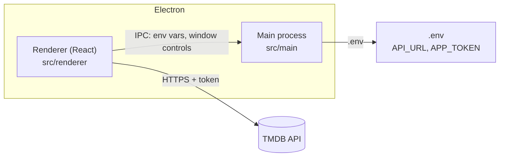

# Electron Theater

[](https://github.com/orlandovallejos/electron-theater/actions/workflows/ci.yml)
[](LICENSE)

> How many times have you sat on the couch with no idea what to watch, scrolling endlessly?
> **Electron Theater** lets two people swipe through movies and shows. When both like the same title,
> it's a **match**, and it goes onto a shared list. Tinder, but for movies.


> **Status:** the project is being revived. Browsing and details work today; swiping, matching and the
> shared list are not built yet. See the [roadmap](docs/ROADMAP.md).

## Features

**Built today**

- Home screen with a random hero banner and rows of trending movies and TV shows
- Poster borders tinted from each title's artwork
- Detail view with backdrop, poster, rating, tagline, overview, YouTube trailer, status, language, budget
  and revenue
- Frameless window with custom close, minimize and fullscreen controls

**Planned** (see the [roadmap](docs/ROADMAP.md))

- Watchlist that survives restarts
- Real-time matching between two people
- An AI assistant for "what should we watch tonight?"

## Tech stack

- [Electron](https://www.electronjs.org/) with [React](https://react.dev/) and
  [TypeScript](https://www.typescriptlang.org/)
- [React Router](https://reactrouter.com/), [styled-components](https://styled-components.com/)
- [axios](https://axios-http.com/) for [The Movie Database (TMDB)](https://www.themoviedb.org/) API calls
- [Webpack](https://webpack.js.org/), built from the
  [electron-react-boilerplate](https://github.com/electron-react-boilerplate/electron-react-boilerplate)
  template
- [Jest](https://jestjs.io/) and [Enzyme](https://enzymejs.github.io/enzyme/) for tests, ESLint and
  Prettier for code style, GitHub Actions for CI

The versions are dated. Updating them is the plan for milestone M1.

## Architecture



| Part              | Where                      | What it does                                                                            |
| ----------------- | -------------------------- | --------------------------------------------------------------------------------------- |
| Main process      | `src/main`                 | Creates the window and menu, loads `.env`, and handles IPC for window controls          |
| Renderer          | `src/renderer`             | The React UI: `Home`, `MovieView`, `Layout` and shared components in `common`           |
| API client        | `src/api`, `src/config`    | An axios client that adds the TMDB token, and transforms for movie and series responses |
| Helpers and types | `src/helpers`, `src/types` | Image URLs, dates, and shared types                                                     |

Today the renderer reads the TMDB token from the main process over IPC and calls TMDB directly. Moving that
behind the main process is planned for milestone M2.

## Getting started

### Prerequisites

- [Node.js](https://nodejs.org/) matching [`.nvmrc`](.nvmrc), for example with
  [nvm](https://github.com/nvm-sh/nvm): `nvm install && nvm use`
- [Yarn 1](https://classic.yarnpkg.com/) (`npm install -g yarn`)
- A free [TMDB account](https://www.themoviedb.org/signup) and its **API Read Access Token**

### Set up and run

1. Clone the repository and go into it:

   ```bash
   git clone https://github.com/orlandovallejos/electron-theater.git
   cd electron-theater
   ```

2. Install the dependencies (this also sets up the Git hooks):

   ```bash
   yarn install
   ```

3. Create your environment file and set `APP_TOKEN`:

   ```bash
   cp .env.example .env
   ```

   | Variable    | Required | Description                                                                                                                                   |
   | ----------- | -------- | --------------------------------------------------------------------------------------------------------------------------------------------- |
   | `API_URL`   | yes      | TMDB API base URL. The default in `.env.example` is correct.                                                                                  |
   | `APP_TOKEN` | yes      | Your TMDB **API Read Access Token**, from your [TMDB API settings](https://www.themoviedb.org/settings/api). It is not the shorter "API Key". |

   `.env` is git-ignored. Without a valid token the app can't load movies.

4. Start the app:

   ```bash
   yarn start
   ```

   Restart it after changing `.env`. In development you will see a harmless
   `Invalid header: Does not start with Cr24` error from the devtools extension install
   ([#28](https://github.com/orlandovallejos/electron-theater/issues/28)).

## Scripts

| Command          | What it does                                                           |
| ---------------- | ---------------------------------------------------------------------- |
| `yarn start`     | Run the app in development with hot reload                             |
| `yarn lint`      | Lint with ESLint                                                       |
| `yarn typecheck` | Type-check with TypeScript                                             |
| `yarn test`      | Run the tests with coverage; fails if coverage is below the thresholds |
| `yarn build`     | Build the main and renderer bundles                                    |
| `yarn package`   | Build and package an installer into `release/build`                    |

## Contributing

Contributions are welcome. Read [CONTRIBUTING.md](CONTRIBUTING.md) for the workflow, branch and commit
conventions, and the review checklist. Planned work is tracked on the
[roadmap board](https://github.com/users/orlandovallejos/projects/1), in
[issues and milestones](https://github.com/orlandovallejos/electron-theater/milestones), and described in the
[roadmap](docs/ROADMAP.md). Decisions with trade-offs are recorded in [docs/adr](docs/adr/README.md).

## License

[MIT](LICENSE)
