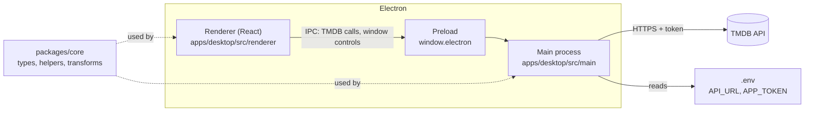

# Electron Theater

[](https://github.com/orlandovallejos/electron-theater/actions/workflows/ci.yml)
[](LICENSE)

> How many times have you sat on the couch with no idea what to watch, scrolling endlessly?
> **Electron Theater** lets two people swipe through movies and shows. When both like the same title,
> it's a **match**, and it goes onto a shared list. Tinder, but for movies.


> **Status:** the project is being revived. Browsing and details work today; swiping, matching and the
> shared list are not built yet. See the [roadmap](docs/ROADMAP.md).

## Features

**Built today**

- Home screen with a random hero banner and rows of trending movies and TV shows
- Poster borders tinted from each title's artwork
- Detail view with backdrop, poster, rating, tagline, overview, YouTube trailer, status, language, budget
  and revenue
- Frameless window with custom close, minimize and fullscreen controls

**Planned** (see the [roadmap](docs/ROADMAP.md))

- Watchlist that survives restarts
- Real-time matching between two people
- An AI assistant for "what should we watch tonight?"

## Tech stack

- [Electron](https://www.electronjs.org/) 45 with [React](https://react.dev/) 18 and
  [TypeScript](https://www.typescriptlang.org/) 5.9
- [React Router](https://reactrouter.com/), [styled-components](https://styled-components.com/) and
  [MUI Joy](https://mui.com/joy-ui/getting-started/)
- [axios](https://axios-http.com/) for [The Movie Database (TMDB)](https://www.themoviedb.org/) API calls, made
  from the main process
- [Webpack](https://webpack.js.org/) and [electron-builder](https://www.electron.build/), from the
  [electron-react-boilerplate](https://github.com/electron-react-boilerplate/electron-react-boilerplate)
  template
- [Jest](https://jestjs.io/) and [React Testing Library](https://testing-library.com/docs/react-testing-library/intro/)
  for tests, ESLint and Prettier for code style
- An [npm workspaces](https://docs.npmjs.com/cli/using-npm/workspaces) monorepo, with GitHub Actions running
  lint, type checks, tests, the build and a Linux installer build on every pull request

## Repository layout

```
apps/
  desktop/        the Electron app
    src/main/       main process: window, menu, IPC handlers, TMDB client
    src/renderer/   React UI: Home, MovieView, Layout, shared components in common/
    src/api/        typed wrapper over the TMDB API the preload script exposes
    release/app/    what ships inside the installer
    .erb/           webpack configs and build scripts
packages/
  core/           types and pure logic shared by every client: date, math and image helpers, TMDB transforms
  config/         shared Prettier, TypeScript and ESLint settings
docs/             roadmap, ADRs, security notes
```

The web client, the mobile app and the backend will be added next to these (see the
[roadmap](docs/ROADMAP.md#target-architecture)). What goes in a shared package and what stays in an app is in
[ADR 4](docs/adr/0004-monorepo-layout.md).

## Architecture



| Part         | Where                              | What it does                                                                         |
| ------------ | ---------------------------------- | ------------------------------------------------------------------------------------ |
| Main process | `apps/desktop/src/main`            | Creates the window and menu, loads `.env`, makes every TMDB request, and handles IPC |
| Preload      | `apps/desktop/src/main/preload.js` | Exposes a small typed `window.electron` API to the renderer and nothing else         |
| Renderer     | `apps/desktop/src/renderer`        | The React UI: `Home`, `MovieView`, `Layout` and shared components in `common`        |
| API wrapper  | `apps/desktop/src/api`             | Thin, typed wrapper over `window.electron.tmdb`                                      |
| Shared code  | `packages/core`                    | Domain types, the date / math / image helpers, and the transforms for TMDB responses |

The TMDB token only exists in the main process; the renderer never sees it
([ADR 2](docs/adr/0002-tmdb-calls-in-main-process.md), [SECURITY.md](SECURITY.md)).

## Getting started

### Prerequisites

- [Node.js](https://nodejs.org/) matching [`.nvmrc`](.nvmrc), for example with
  [nvm](https://github.com/nvm-sh/nvm): `nvm install && nvm use`
- A free [TMDB account](https://www.themoviedb.org/signup) and its **API Read Access Token**

### Set up and run

1. Clone the repository and go into it:

   ```bash
   git clone https://github.com/orlandovallejos/electron-theater.git
   cd electron-theater
   ```

2. Install the dependencies (this also sets up the Git hooks):

   ```bash
   npm install
   ```

3. Create the desktop app's environment file and set `APP_TOKEN`:

   ```bash
   cp apps/desktop/.env.example apps/desktop/.env
   ```

   | Variable    | Required | Description                                                                                                                                   |
   | ----------- | -------- | --------------------------------------------------------------------------------------------------------------------------------------------- |
   | `API_URL`   | yes      | TMDB API base URL. The default in `.env.example` is correct.                                                                                  |
   | `APP_TOKEN` | yes      | Your TMDB **API Read Access Token**, from your [TMDB API settings](https://www.themoviedb.org/settings/api). It is not the shorter "API Key". |

   `.env` is git-ignored. Without a valid token the app can't load movies.

4. Start the app:

   ```bash
   npm start
   ```

   Restart it after changing `.env`. In development you will see a harmless
   `Invalid header: Does not start with Cr24` error from the devtools extension install
   ([#28](https://github.com/orlandovallejos/electron-theater/issues/28)).

## Scripts

| Command             | What it does                                                           |
| ------------------- | ---------------------------------------------------------------------- |
| `npm start`         | Run the app in development with hot reload                             |
| `npm run lint`      | Lint with ESLint                                                       |
| `npm run typecheck` | Type-check with TypeScript                                             |
| `npm test`          | Run the tests with coverage; fails if coverage is below the thresholds |
| `npm run build`     | Build the main and renderer bundles                                    |
| `npm run package`   | Build and package an installer into `apps/desktop/release/build`       |

Run from the repo root. `lint`, `typecheck` and `test` run in every workspace; to run one workspace only, add
`-w` and its name, for example `npm test -w @electron-theater/core`.

## Contributing

Contributions are welcome. Read [CONTRIBUTING.md](CONTRIBUTING.md) for the workflow, branch and commit
conventions, and the review checklist. Planned work is tracked on the
[roadmap board](https://github.com/users/orlandovallejos/projects/1), in
[issues and milestones](https://github.com/orlandovallejos/electron-theater/milestones), and described in the
[roadmap](docs/ROADMAP.md). Decisions with trade-offs are recorded in [docs/adr](docs/adr/README.md).

## License

[MIT](LICENSE)
