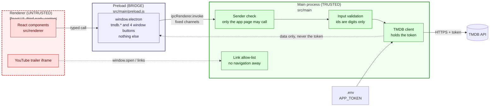
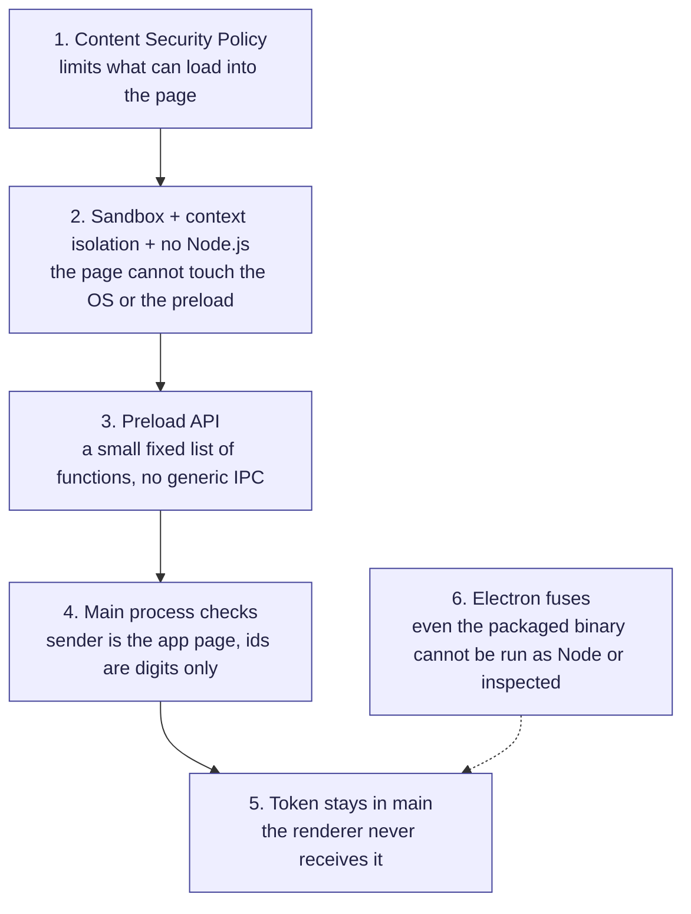

# Security

Movie Mates is a desktop app, so the main risk is a malicious page, script or link
getting more power than it should. This document explains how the app is protected and how to
report a problem.

## Supported versions

The project is pre-release (no published builds yet). Only the latest commit on `main` is supported.

## Reporting a vulnerability

Please do **not** open a public issue for a security problem.

Use GitHub's private reporting: go to the repository's **Security** tab and choose
**Report a vulnerability**. Include what you found, the steps to reproduce it, and the impact
you expect. You will get a first answer within a few days. This is a one-person project, so
please be patient.

## Security model

The app has three parts, and each one gets only the power it needs.

| Part                                         | Trust     | What it can do                                                                |
| -------------------------------------------- | --------- | ----------------------------------------------------------------------------- |
| Main process (`apps/desktop/src/main`)       | Trusted   | Holds the TMDB token, makes every TMDB request, opens links, controls windows |
| Preload (`apps/desktop/src/main/preload.js`) | Bridge    | Exposes a small, typed `window.electron` API and nothing else                 |
| Renderer (`apps/desktop/src/renderer`)       | Untrusted | Draws the UI. Has no token, no Node.js and no direct network access to TMDB   |

The layers of protection, from the outside in. An attacker who gets code into the renderer has to get
through every layer to reach the token or the operating system:

The protections, and where they live:

- **The TMDB token never reaches the renderer.** The main process owns it and the renderer asks for
  results over fixed IPC channels. See [ADR 2](docs/adr/0002-tmdb-calls-in-main-process.md).
- **Sandbox and isolation.** The renderer runs with `sandbox: true`, `contextIsolation: true` and
  `nodeIntegration: false`, and web security (the same-origin policy) is on.
- **Content Security Policy.** `apps/desktop/src/renderer/index.ejs` limits where scripts, styles, fonts, images and
  frames can load from. Each allowance is explained in a comment next to it.
- **IPC validation.** Every handler checks that the message comes from the app's own page, and ids from
  the renderer must be digits only (`apps/desktop/src/main/main.ts`, `apps/desktop/src/main/security.ts`).
- **Links and navigation.** The app opens only `https` links to an allow-listed set of hosts in the
  user's browser, and the window cannot navigate away from the app page.
- **Electron fuses.** The packaged app turns off `RunAsNode`, the `NODE_OPTIONS` variable and the
  `--inspect` flags, turns on cookie encryption and ASAR integrity validation, and loads code only
  from the ASAR archive (`electronFuses` in `package.json`).

## Known limitations

- **The token is still on the user's machine.** The main process reads it from a `.env` file, so anyone with
  access to the computer can read it. The TMDB read token is free and can be revoked. Keeping it out of
  the app entirely would need a backend that holds it (planned as part of the multiplayer work).
- **Builds are not code-signed or notarized yet**, and there are no published releases or auto-update
  channel (planned for M7). Do not install builds from unofficial sources.
- **The YouTube trailer player is third-party content** loaded in an iframe. The CSP only allows
  `youtube-nocookie.com` for frames.
