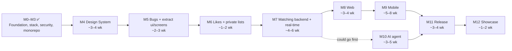

# Movie Mates — Roadmap

> After a long day, you sit down after dinner to watch something, and with so many options it takes
> longer to pick than to watch. **Movie Mates** fixes that. During the week, each person likes the movies
> and shows they'd want to see. Their likes stay private. When two connected people like the same title,
> it's a **match**, and it goes onto the list they share. When it's time to watch, you open that list and
> pick from things you both already want.

This document explains where the project is today, where it's going, and how the work is
organized. It is a living document: it's updated whenever a milestone closes or the plan changes.

**Contents**

1. [Why this project exists](#1-why-this-project-exists)
2. [Current state](#2-current-state)
3. [Known problems](#3-known-problems)
4. [Direction](#4-direction)
5. [Milestones](#5-milestones)
6. [How work is organized](#6-how-work-is-organized)

---

## 1. Why this project exists

The idea comes from a problem at home: two people who want to watch something together and can't agree,
scrolling until it's too late to start. Each of you already knows what you like; the app only has to find
the overlap, without either of you having to share your whole list.

The project was started in 2021 and paused after the movie detail view shipped. It's being
revived with two goals:

1. **Learning:** a real codebase for practising modern engineering: Electron security, dependency
   upgrades, CI/CD, testing, monorepos and design systems, real-time systems (WebSockets), mobile and
   web clients, and AI agents.
2. **Working like a team:** every change is planned in an issue, built on a branch, described in a
   pull request, and reviewed.

## 2. Current state

Electron desktop app with a React renderer, built on
[electron-react-boilerplate](https://github.com/electron-react-boilerplate/electron-react-boilerplate),
using [The Movie Database (TMDB)](https://www.themoviedb.org/) API. The stack is current (Electron 45,
React 18, React Router 6, TypeScript 5.9, Jest 30 with React Testing Library, ESLint 9), CI runs on every
pull request and builds the Linux installer, and the security work of M2 is done. Since M3 the repo is an npm
workspaces monorepo: the app is in `apps/desktop`, shared code in `packages/core` and shared tooling settings
in `packages/config`.

| Area        | What exists                                                                                                       | Where                                                              |
| ----------- | ----------------------------------------------------------------------------------------------------------------- | ------------------------------------------------------------------ |
| Home        | Random hero banner, rows of trending movies and TV shows, poster borders tinted from the artwork (`node-vibrant`) | `apps/desktop/src/renderer/Home`                                   |
| Detail view | Backdrop, poster, rating ring, tagline, overview, YouTube trailer modal, status / language / budget / revenue     | `apps/desktop/src/renderer/MovieView`                              |
| Window      | Frameless, sandboxed window with custom close / minimize / fullscreen controls over validated IPC                 | `apps/desktop/src/main`, `apps/desktop/src/renderer/common/AppBar` |
| Data        | TMDB calls run in the main process, so the token never reaches the renderer; the renderer uses a typed API        | `apps/desktop/src/main/tmdb.ts`, `apps/desktop/src/api`            |

**Not built yet:** the core idea. There are no accounts, no likes or lists, no matches, and no shared lists.

## 3. Known problems

Each one maps to a milestone below. Crossed-out items are fixed.

### Bugs → M5

- ~~The detail view only re-fetches when `movieId` changes, so going from one TV show to another shows stale data.~~ Fixed in #34 (the effect also depends on `serieId`).
- The hero's **Trailer** and **Watchlist** buttons have no handlers.
- The detail page's left column only shows the title. Credits, keywords, and similar titles are fetched but never used.
- If the TMDB configuration request fails, the app renders a blank screen forever. There are no loading or error states.
- `AppBar` re-adds its scroll listener on every render.
- ~~`yarn test` exits with an error because coverage is below the thresholds (#27).~~ Fixed in #80.

### Security → M2

All of these are fixed in M2:

- ~~`webSecurity: false` on the main window.~~ Fixed in #76. The renderer is also sandboxed.
- ~~The TMDB token is sent to the renderer over IPC, so it's readable from DevTools.~~ Fixed in #75: the main process makes the TMDB calls (see [ADR 2](adr/0002-tmdb-calls-in-main-process.md)).
- ~~Icons are loaded from a CDN at runtime, and there's no Content Security Policy.~~ Fixed in #76.
- ~~Uses the deprecated `new-window` event instead of `setWindowOpenHandler`.~~ Fixed in #62.
- ~~IPC handlers do not check who is calling, and any URL opens in the system browser.~~ Fixed in #76.
- ~~The packaged app ships with Electron's default fuses.~~ Fixed in #74.

What the security model is, and how to report a problem, is in [SECURITY.md](../SECURITY.md).

### Hygiene → M0

- ~~Package metadata still identifies the app as electron-react-boilerplate, and auto-update points at the boilerplate's repo.~~ Fixed in #14.
- ~~The git pre-commit hook never runs: husky 7 is installed, but the config uses the husky 4 format.~~ Fixed in #19.
- ~~IPC channel names are duplicated in two files.~~ Fixed in #75: they live in `apps/desktop/src/constants/appEvents.cjs`.

### Outdated stack → M1

Fixed in M1. The stack was Node 14, Electron 15, React 17, React Router 5, TypeScript 4.4, axios 0.23,
Jest 27, Enzyme, and a `@mui/joy` alpha. It is now Node 24, Electron 45, React 18, React Router 6,
TypeScript 5.9, axios 1.x, Jest 30 and React Testing Library, with ESLint 9 (flat config) and webpack 5.
`@mui/joy` is still a beta release (`5.0.0-beta`), and ESLint stays on 9 because `eslint-plugin-react` does not
support ESLint 10 yet. React Router stays on 6 until the migration in M5 (#114), and TypeScript stays on 5.9 until
ts-loader, ts-jest and typescript-eslint support TypeScript 7 (#115).

## 4. Direction

The app grows from one desktop client into three clients (desktop, web, mobile) on one backend, plus an AI
agent. This section is the shared picture; the milestones below are the steps.

### Principles

1. **Free services only.** Hosting, database, auth, tracing and models must have a free tier. Each choice is
   recorded in an ADR with a fallback, and the limits are checked right before the milestone that needs them
   (free tiers change).
2. **Share code in layers.** Share types, logic and the API client everywhere; share visual components only
   where they can really run (the DOM apps); keep platform-specific parts behind small adapters.
3. **One source of truth for the look.** Colors, type, spacing and the rest are design tokens defined once.
   Changing a token (for example the primary color) updates every client. M12 proves it.
   The [design principles and the component inventory](design/README.md) say how the tokens are used.
4. **Decisions are written down.** Trade-offs go in ADRs (`docs/adr/`), not only in pull requests. Product
   decisions go in the [product requirements](product/requirements.md#6-decisions).
5. **Small, reviewable changes.** See [How work is organized](#6-how-work-is-organized).

### How likes, lists and matches work

There are two kinds of lists, and every list belongs to one person:

- **Likes.** Each person has exactly one. Tapping the heart on a movie or show adds it. Likes are private:
  nobody can see them, including the people you're connected to. They are the only list the app uses to
  find matches.
- **Your own lists.** Create as many as you want, for example "Action and war" or "Horror to watch alone",
  and put any movie or show in them. They are always private and never used for matching. They're saved to
  your account, so they're the same on every device.

Matching between two people:

- **Connections need consent.** You invite someone (a partner, a sibling, a friend), and Likes are only
  compared after they accept. Either person can end the connection.
- **One shared list per connection.** When you like a title, the backend checks it against the Likes of
  each person you're connected to. Only the titles you have in common show up on the list you share.
- **No live session needed.** Each person likes titles whenever it suits them. A notification tells you
  when a new match appears.
- **Streaming services mark, never hide.** Later, you can say which services you have, and titles on them
  get a tick (TMDB lists where each title is available). Nothing is hidden because it's on another service.
- **No cap on Likes.** Nobody liking titles by hand gets near "everything", so there's no limit on how many
  titles you can like. The backend still has ordinary API rate limits against scripts.

Every feature, the clients that get it and the milestone that builds it, plus the product decisions and the
ideas we decided not to build, are in the [product requirements](product/requirements.md).

### Target architecture

The layout, the rules for what goes in a shared package, and the trade-offs are in
[ADR 4](adr/0004-monorepo-layout.md). The package manager is npm ([ADR 3](adr/0003-use-npm.md)).

```
apps/
  desktop      Electron app (today's code)
  web          browser client
  mobile       Expo / React Native
packages/
  core         types, pure logic, response transforms
  tokens       design tokens and the Tailwind theme generated from them
  api-client   ApiClient interface and its HTTP implementation
  ui           presentational components (DOM only)
  screens      Home, MovieView, ... built from ui; platform parts are injected
  config       shared Prettier, ESLint and TypeScript settings
services/
  backend      API + WebSocket server (Node, Docker)
  agent        AI agent (Python)
```

| Package      | Desktop | Web | Mobile                   |
| ------------ | ------- | --- | ------------------------ |
| `core`       | yes     | yes | yes                      |
| `tokens`     | yes     | yes | yes                      |
| `api-client` | yes     | yes | yes                      |
| `ui`         | yes     | yes | no (own UI, same tokens) |
| `screens`    | yes     | yes | no (own screens)         |
| `config`     | yes     | yes | yes                      |

Shared screens do not know which platform they run on. They ask React context for an `ApiClient`, a way to
open external links, and so on. The desktop app supplies an IPC-backed `ApiClient` (today's
`window.electron.tmdb`), and the web client supplies an HTTP one. Window controls stay desktop-only.

The mobile app cannot reuse DOM components, so it shares `core`, `api-client` and the design tokens instead.
That keeps its look consistent without a "universal UI" layer.
Styling is Tailwind on desktop and web, and the same classes on mobile (Uniwind or NativeWind, picked in M9).
The reasons, and the alternative of one React Native component set for every client, are in
[ADR 5](adr/0005-styling-and-design-tokens.md).

### Open question: what is the desktop app for?

If the desktop app only wraps the web app, there is no reason for it to exist. Liking titles on the go fits a phone best,
and the web client needs no install, so the desktop app must do something the others cannot. This is
**undecided**. The leading idea: a player and library for your own video files, possibly with AI features for
the videos you add (still to be explored, including how hard that is). Decide it after the
clients exist and it is clearer what is missing, and record it in an ADR.

## 5. Milestones

Milestones are ordered: foundation and safety first, then the shared structure, then features and clients.
Each one has a clear "done when", so it's obvious when it can close. M0–M3 are done; the rest is the plan.

|     | Milestone                                                                                   | Goal                                                          | Done when                                                                                                                                                        |
| --- | ------------------------------------------------------------------------------------------- | ------------------------------------------------------------- | ---------------------------------------------------------------------------------------------------------------------------------------------------------------- |
| M0  | [Project Foundation](https://github.com/orlandovallejos/movie-mates/milestone/1)            | Run the repo like a professional project                      | Every PR runs CI, and a new contributor can run the app from the README alone                                                                                    |
| M1  | [Stack Modernization](https://github.com/orlandovallejos/movie-mates/milestone/2)           | Pay down dependency debt, one upgrade per PR                  | Supported versions everywhere, no deprecated APIs, tests pass                                                                                                    |
| M2  | [Security & Architecture](https://github.com/orlandovallejos/movie-mates/milestone/3)       | Follow Electron's security checklist                          | The API token never reaches the renderer; no Electron security warnings                                                                                          |
| M3  | [Monorepo Foundation](https://github.com/orlandovallejos/movie-mates/milestone/9)           | Make room for web and mobile without duplicating work         | CI green on the new layout, installer still builds, `core` holds the shared code                                                                                 |
| M4  | [Design System](https://github.com/orlandovallejos/movie-mates/milestone/10)                | One look and feel across all clients, defined once            | Every color, space and font comes from tokens; guardrails run in CI                                                                                              |
| M5  | [Bug Fixes & UX Polish](https://github.com/orlandovallejos/movie-mates/milestone/4)         | Make existing features reliable; extract `ui` and `screens`   | No known bugs; every screen handles failure; coverage threshold met; desktop uses the packages                                                                   |
| M6  | [Likes & Private Lists](https://github.com/orlandovallejos/movie-mates/milestone/5)         | Like titles and organize them in your own private lists       | The heart adds a title to your Likes, you can create and fill your own lists, and both survive restarts and are tested                                           |
| M7  | [Matching: Backend & Real-time](https://github.com/orlandovallejos/movie-mates/milestone/6) | Build the core idea on free infrastructure                    | Two users on different machines connect by invite, like titles on their own, and get notified of a match on their shared list; neither can see the other's Likes |
| M8  | [Web Client](https://github.com/orlandovallejos/movie-mates/milestone/11)                   | Use it from a browser with nothing to install                 | Sign in, connect, like and see matches on the web, sharing components with desktop                                                                               |
| M9  | [Mobile App](https://github.com/orlandovallejos/movie-mates/milestone/12)                   | Like titles and check matches from a phone                    | A phone user and a desktop or web user connect and see their matches                                                                                             |
| M10 | [AI Movie Agent](https://github.com/orlandovallejos/movie-mates/milestone/7)                | A "what should we watch tonight?" assistant we build and host | Grounded recommendations, every run traceable, the model swappable by configuration                                                                              |
| M11 | [Release & Quality](https://github.com/orlandovallejos/movie-mates/milestone/8)             | Ship it like a real product, for all three clients            | One tagged release builds desktop installers, deploys the web client and makes a mobile build                                                                    |
| M12 | [Showcase](https://github.com/orlandovallejos/movie-mates/milestone/13)                     | Show the work, not just claim it                              | One tokens change updates all three clients; write-up and demo published                                                                                         |

The order can change where a dependency allows it. In particular, M10 (the AI agent) only needs the backend, so
it could move before M8 and M9 if it becomes the priority.

Milestones were renumbered on 2026-11-07. Older closed issues and pull requests that mention "M3" or "M4" use the
old numbers (Bug Fixes & UX Polish and Watchlist & Persistence).

### Path and estimate



| Milestone | Weeks (calendar)             |
| --------- | ---------------------------- |
| M3        | 1–2 (took 3 days)            |
| M4        | 3–4                          |
| M5        | 2–3                          |
| M6        | 1–2                          |
| M7        | 4–6                          |
| M8        | 3–4                          |
| M9        | 5–8                          |
| M10       | 3–5                          |
| M11       | 3–4                          |
| M12       | 1–2                          |
| **Total** | **about 26–40 (6–9 months)** |

These are rough guesses, not commitments. They assume 1–2 hours a day (about 7–14 hours a week) and are given in
durations, not dates, because dates go stale when a week is skipped. M7 and M9 are the least certain, since they bring
new infrastructure and a new platform. Revisit the numbers when each milestone closes.

### The one-place theming proof (M12)

The test of the design system: change the primary color from green to pink, or the base padding, or the font
family, in the token files only, and see all three clients update. The proof is one pull request that touches
one tokens file, with before/after screenshots of desktop, web and mobile. It is done last, but the groundwork
is in M4: tokens feed both the DOM apps and React Native, a lint rule rejects hard-coded colors and spacing,
and screenshot tests catch visual changes. That keeps the final proof from becoming a hunt for hard-coded values.

### Learning map

| Milestone | Skills practised                                                                      |
| --------- | ------------------------------------------------------------------------------------- |
| M0        | GitHub workflow, CI with GitHub Actions, documentation, ADRs                          |
| M1        | Safe incremental upgrades, build tooling, test migration                              |
| M2        | Electron process model, IPC design, CSP, secrets handling                             |
| M3        | Monorepos and workspaces, shared packages, keeping CI and packaging working           |
| M4        | Design tokens, theming across platforms, accessibility, Storybook, visual regression  |
| M5        | React data fetching (TanStack Query), error handling, testing, extracting a library   |
| M6        | Local persistence (electron-store or SQLite), state management, list UX               |
| M7        | Backend design, auth, WebSockets, Docker, deploying on free tiers                     |
| M8        | Reusing components across apps, dependency injection through adapters, static hosting |
| M9        | React Native and Expo, sharing logic (not UI) with web                                |
| M10       | LLM tool use, agent design in Python, tracing and evals (LangSmith), open models      |
| M11       | E2E testing (Playwright), code signing, auto-update, observability                    |
| M12       | Technical writing, demos, proving architectural claims                                |

## 6. How work is organized

```
Milestone ──▶ Issue ──▶ Branch ──▶ Commits ──▶ Pull request ──▶ Review ──▶ Squash merge
   M0          #12     docs/12-…   docs: …      "Closes #12"
```

- **Issues** state the problem, the proposal, and a checklist of acceptance criteria. Each has a
  milestone and labels: `type: …` (bug, feature, docs, chore, refactor, security, tech-debt,
  test, ci), `area: …` (main, renderer, api, backend, ai, infra), and `priority: …`.
- **Branches** are named `<type>/<issue-number>-<short-slug>`, e.g. `fix/14-movieview-stale-series`.
- **Commits** follow [Conventional Commits](https://www.conventionalcommits.org/), e.g.
  `fix: refetch series when the route changes`.
- **Pull requests** are small and focused, aim for roughly 300 to 500 changed lines (not counting lock files), link
  their issue with `Closes #N`, and say how the change was tested. A change that depends on an unmerged one is a
  **stacked** PR: its base is the previous branch, and after the previous one is merged, GitHub moves it to
  `main` and offers **Update branch**.
- **Decisions** with real trade-offs are recorded as ADRs in `docs/adr/` (see #20).

Progress is tracked on the [Movie Mates Roadmap board](https://github.com/users/orlandovallejos/projects/1)
(statuses: Backlog, Ready, In progress, In review, Done; fields: Milestone, Priority, Size).

Full contribution guidelines: [CONTRIBUTING.md](../CONTRIBUTING.md).
