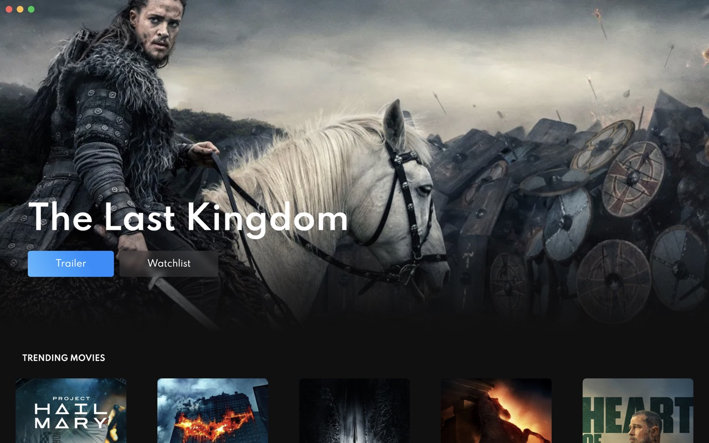
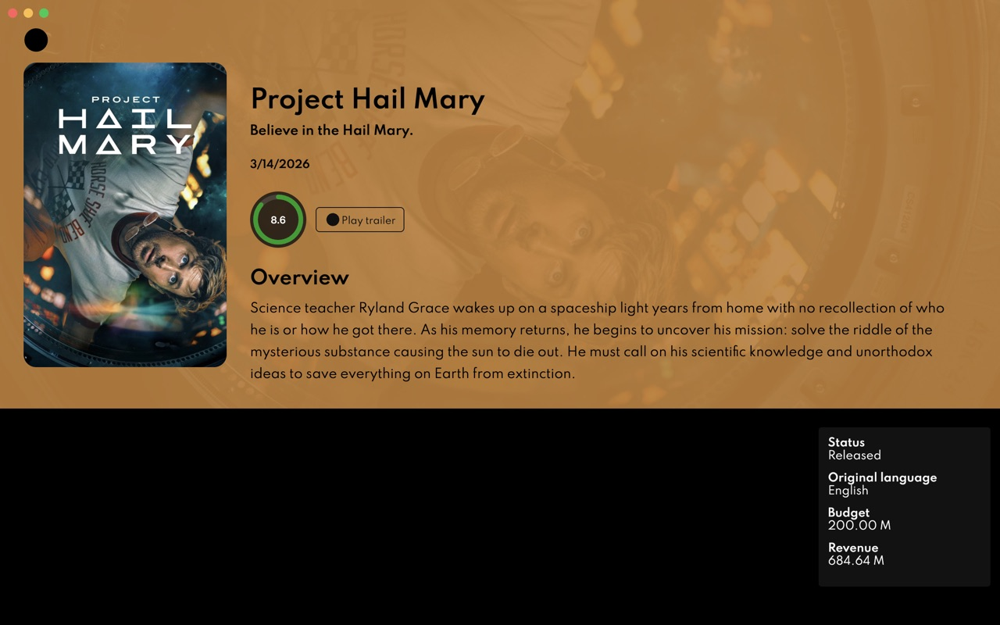
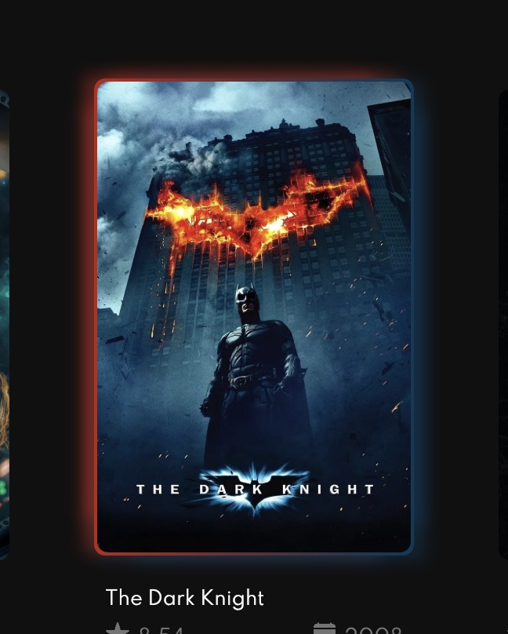
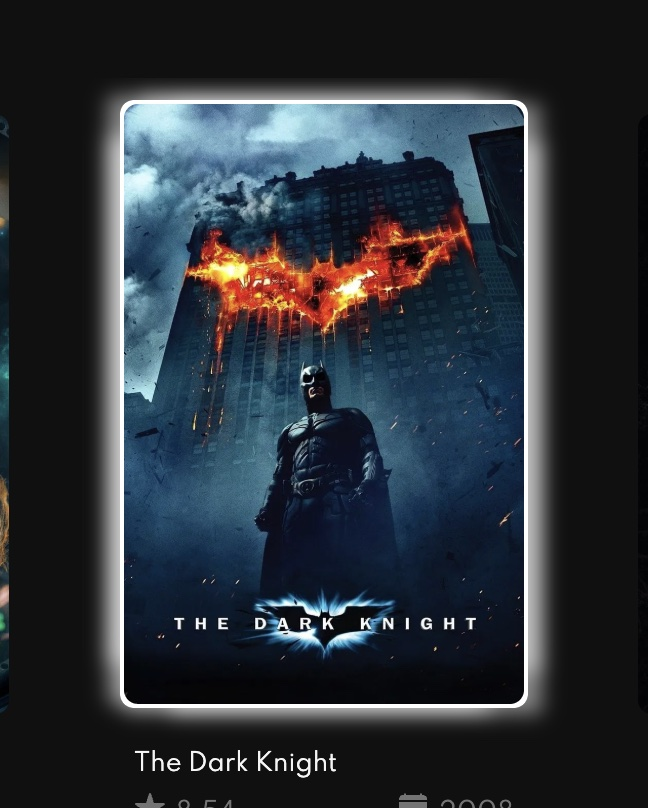

# UI audit (before the design system)

- **Date:** 2026-11-09
- **Scope:** the desktop renderer, `apps/desktop/src/renderer` (10 `style.ts` files, the theme, `Icon` and `App.global.css`: about 550 lines of styles)
- **Why:** M4 replaces hard-coded values with design tokens. This is the "before": what the app uses today,
  measured instead of guessed, so the tokens (#124) start from real values and the migration (#127, #128) has
  something to compare against.

Paths below are relative to `apps/desktop/src/renderer`.

## Summary

- **Two styling systems in use, a third installed but unused.** styled-components styles every component;
  Joy UI (on Emotion) draws the rating circle and the trailer modal; Sass is wired into webpack, but no
  `.scss` file exists (`App.global.css` is plain CSS).
- **17 distinct hex colors and 3 named colors** for an app with two screens. 11 of them are used once.
  `#101010`, the most used color (6 times), is not in the theme.
- **The theme is barely used.** `themes/default.ts` has 6 values. Three files import it directly; no
  component reads it from `ThemeProvider`, so the provider in `App.tsx` does nothing.
- **No spacing scale.** 16 different spacing values (2 to 100 px), almost all used once.
- **8 font sizes, 5 radii, no shadows outside the poster hover, no type scale.** Headings use the browser's
  default sizes.
- **Accessibility:** focus outlines are removed on every button, the back button has no name, and the
  primary button's text fails contrast. Details [below](#accessibility-gaps).
- **Three visible bugs** turned up in the running app: the poster hover glow is white instead of the poster's
  colors in development, outline icons render as black circles, and an invisible title sits under the
  MovieView header. See [Screenshots](#screenshots-before).

## Colors

| Value                           |   Uses | Where                                                                                 | Notes                                                        |
| ------------------------------- | -----: | ------------------------------------------------------------------------------------- | ------------------------------------------------------------ |
| `#101010`                       |      6 | Home content and section background, Hero gradient, outlined button, vote circle      | The real page background, but not in the theme               |
| `#fff` / `#ffffff`              |      5 | section headings, button text, fallback poster tint (`DEFAULT_COLOR` ×2), rating text | Same color, two spellings                                    |
| `#000`                          |      3 | theme `background.primary`, Hero and MovieView header behind the image                |                                                              |
| `white` (named)                 |      1 | Hero title                                                                            | A third spelling of white                                    |
| `#f5f5f5`                       |      1 | theme `fonts.color.primary`                                                           | Used by the poster title and the MovieView info panel        |
| `#121212`                       |      1 | theme `background.content`                                                            | MovieView info card                                          |
| `#a7a7a7`                       |      1 | theme `fonts.color.secondary`                                                         | **Unused**                                                   |
| `#747474`                       |      1 | poster rating and year                                                                | Muted text, not in the theme                                 |
| `#068eff` → `#95d8ff`           |      1 | primary button gradient                                                               | The only "brand" color                                       |
| `#a30110`, `#bec103`, `#099b21` | 1 each | rating circle (low, medium, high)                                                     | Overrides Joy's own colors with CSS                          |
| `#99999940`                     |      1 | rating circle track                                                                   | 8-digit hex (25 % alpha)                                     |
| `#ff605c`, `#ffbd44`, `#00ca4e` | 1 each | window buttons (close, minimize, maximize)                                            | Copies of the macOS traffic lights; platform look, not brand |
| `rgba(255,255,255,0)`           |      1 | Hero gradient end                                                                     | "Transparent", written as transparent white                  |
| `red`, `green` (named)          |      2 | `Layout/style.ts`, `MovieView/content.style.ts`                                       | **Debug leftovers**, hidden behind other backgrounds         |

`polished` adds transparency at runtime in three places: `transparentize(0.2, '#101010')` behind the rating,
and the poster and header tints (see [Runtime values](#runtime-values-that-cant-be-tokens)).

**What the tokens need:** roughly one background, one surface (`#121212`), one raised surface, two text colors
(primary and muted), one primary color, three rating colors and a focus color. Light mode doesn't exist yet.

## Typography

- **Font:** Spartan from Google Fonts, linked in `index.ejs` with weights 200, 400 and 600, and set on `body`
  and `button` in `App.global.css`. Weight 200 is never used. `MovieView/content.style.ts` asks for `bold`
  (700), which isn't loaded, so the browser fakes it. The font needs the network at startup, and the CSP
  allows `fonts.googleapis.com` and `fonts.gstatic.com` only for it. Google Fonts now lists the family as
  League Spartan; the old `Spartan` URL still works.
- **Sizes (8):** 12 px ×3 (poster title and meta), 14 px ×2 (section heading, info panel, once through
  `polished`'s `rem()`), 16 px (button), 22 px and 40 px (icon sizes), 60 px (Hero title), plus the browser
  defaults for `h1`, `h2`, `h4` and `h5` in the MovieView header.
- **Weights:** 400, 600 and `bold`, once each.
- **Line heights:** 16 px (outlined button) and 28 px (overview); everything else is the browser default.
- **Text case:** section headings are uppercase through CSS.

## Spacing

16 distinct values, all in styled-components:

| px  | Uses | px  | Uses |
| --- | ---: | --- | ---: |
| 2   |    1 | 20  |    5 |
| 4   |    4 | 24  |    1 |
| 5   |    2 | 26  |    2 |
| 8   |    4 | 30  |    8 |
| 10  |    5 | 40  |    1 |
| 12  |    5 | 50  |    2 |
| 14  |    1 | 80  |    1 |
| 16  |    1 | 100 |    1 |

(Counted per side, so `padding: 30px 30px 0 30px` counts 30 three times.) Most values are close to a 4 px
grid; the odd ones out are 2, 5, 10, 14, 26, 30 and 50. Moving to a 4 px scale changes those by 1 to 2 px,
which is the kind of change #127 and #128 should list.

Fixed sizes that aren't spacing: poster card 230 px wide, image 200 × 300 px, MovieView side panel 220 px,
MovieView poster 390 px tall, Hero at least 60 vh, Hero info at least 350 px wide.

## Radii, shadows, motion and layers

- **Radius (5 values):** 4 px (theme, info card), 5 px ×2 (buttons), 7 px ×2 (poster), 16 px (MovieView
  poster), 30 px (trailer frame), 50 % ×2 (window buttons, rating circle).
- **Shadows:** only the poster hover, six layered shadows tinted with the poster's colors (runtime).
- **Blur:** `backdrop-filter: blur(5px) contrast(0.8)` ×2 (app bar on scroll, secondary button).
- **Motion:** `transition: all 0.5s` ×2 (buttons) and `box-shadow 0.5s, transform 0.5s` (poster lift of
  5 px). No easing is set, and nothing respects `prefers-reduced-motion`.
- **Layers:** `z-index: 1` ×2 (app bar, back button).

## Styling libraries

| Library                                                  | Version in use                     | Files                                                                                               | What depends on it                                                                                                                                                    | Status (checked 2026-11-09)                                                                                                                                                                                                               |
| -------------------------------------------------------- | ---------------------------------- | --------------------------------------------------------------------------------------------------- | --------------------------------------------------------------------------------------------------------------------------------------------------------------------- | ----------------------------------------------------------------------------------------------------------------------------------------------------------------------------------------------------------------------------------------- |
| styled-components                                        | 5.3 (pinned by a root `overrides`) | 12: every `style.ts`, `Icon`, `App.tsx` (`ThemeProvider`), `themes/default.ts`, `types/styled.d.ts` | All component styles, about 530 lines                                                                                                                                 | v5's last release was 5.3.11 (May 2023). v6.6 is current, but the maintainer put the project in [maintenance mode](https://opencollective.com/styled-components/updates/thank-you) in March 2025 and advises against it for new projects. |
| `@mui/joy` (with `@emotion/react` and `@emotion/styled`) | 5.0.0-beta.52                      | 1: `MovieView/header.tsx` (`CircularProgress`, `Modal`), plus class overrides in `header.style.ts`  | The rating circle, the trailer modal, and two tests that check Joy's class names                                                                                      | Still beta; the last release was March 2025. MUI says Joy UI is [on hold](https://mui.com/blog/2026-and-beyond/). Emotion is only here because Joy needs it; its last release was December 2024.                                          |
| Sass (`sass`, `sass-loader`)                             | 1.108, 17.1                        | 0                                                                                                   | Nothing. Webpack has `.scss` rules, and `App.global.css` (12 lines of plain CSS) goes through `sass-loader` in production only because the prod rule matches `.s?css` | Active (release this week). Unused here.                                                                                                                                                                                                  |
| `polished`                                               | 4.3.1                              | 3: `PosterItem/style.ts`, `MovieView/header.style.ts`, `MovieView/content.style.ts`                 | `transparentize` for the runtime tints, `rem` once                                                                                                                    | Last release February 2024. Small and stable, but `transparentize` can be replaced by CSS `color-mix()` or 8-digit hex.                                                                                                                   |
| `@teamsupercell/typings-for-css-modules-loader`          | 2.5                                | 0                                                                                                   | The dev webpack rule for `.scss` modules                                                                                                                              | Only useful with Sass modules; nothing uses it.                                                                                                                                                                                           |

So most of the work in #127 and #128 is styled-components; Joy is two components in one file; Sass is a
config change with no code to migrate.

## Runtime values that can't be tokens

These colors come from the poster image at runtime (`node-vibrant`), so they stay as inline styles or CSS
variables after the migration, with a comment. The lint rule in #130 needs an allow-list for them.

| Where                           | What                                                                                                                                                                              | Fallback         |
| ------------------------------- | --------------------------------------------------------------------------------------------------------------------------------------------------------------------------------- | ---------------- |
| `common/PosterItem`             | Hover border gradient and six tinted shadows from the poster's Vibrant and DarkVibrant colors (50 % transparent). Falls back to white in development ([bug](#screenshots-before)) | `#fff` for both  |
| `MovieView/header` (`Shadow`)   | The overlay on the backdrop: the poster's Vibrant color at 90 %                                                                                                                   | `#fff`           |
| `Home/Hero`, `MovieView/header` | The backdrop image itself (`background-image` inline)                                                                                                                             | `#000` behind it |

The fallback (`DEFAULT_COLOR = '#fff'`) is defined twice; it should become a token (`color.surface` or a
dedicated `color.poster-fallback`).

## Accessibility gaps

Contrast ratios are WCAG 2.2; normal text needs 4.5:1, large text (24 px, or 19 px bold) 3:1.

| Gap                                                                                                                                             | Where                              | Severity |
| ----------------------------------------------------------------------------------------------------------------------------------------------- | ---------------------------------- | -------- |
| `outline: none` on every button and no `:focus-visible` style: keyboard users can't see where they are                                          | `Button`, `GoBackButton`, `AppBar` | High     |
| The back button is only an icon (`aria-hidden`) with no `aria-label`, so screen readers announce "button"                                       | `GoBackButton`                     | High     |
| White text on the primary button gradient: 3.3:1 at the darkest point (`#068eff`), worse toward the light end; fails for 16 px text             | `Button` (primary)                 | High     |
| MovieView header text has no color, so it's black on whatever the poster tint is: fine on the white fallback (21:1), unreadable on dark posters | `MovieView/header`                 | High     |
| Hero title is white over the backdrop with a gradient only at the bottom: contrast depends on the image                                         | `Home/Hero`                        | Medium   |
| Poster rating and year: `#747474` on `#101010` is 4.07:1 at 12 px, just under 4.5:1                                                             | `PosterItem`                       | Medium   |
| The low-rating arc (`#a30110` on `#101010`) is 2.3:1; non-text elements need 3:1. The number inside is readable                                 | `MovieView/header`                 | Low      |
| "Trailer" and "Watchlist" on Home are buttons that do nothing                                                                                   | `Home/Hero`                        | Medium   |
| Heading order: Home has two `h1`s; MovieView goes `h1`, `h4`, `h5`, `h2`                                                                        | `Home/Content`, `MovieView/header` | Medium   |
| Window buttons only show their icon on hover (color alone tells them apart)                                                                     | `AppBar`                           | Low      |
| Motion (poster lift, 0.5 s transitions) ignores `prefers-reduced-motion`                                                                        | `PosterItem`, `Button`             | Low      |
| Poster links have a name only when the image loads (`alt` is the title; no `url` means an empty link)                                           | `PosterItem`                       | Low      |

The good parts: the window buttons have labels, posters use the title as `alt`, icons are `aria-hidden`,
and the Joy modal traps focus. The main text colors pass easily (17:1 to 19:1). #135 fixes the rest.

## Screenshots (before)

Taken with the production build (`npm run build`) in a 1280 × 800 window.

| Home                                         | MovieView                                              |
| -------------------------------------------- | ------------------------------------------------------ |
|  |  |

Taken on macOS at 2× and scaled down to 1280 px wide. The Hero title and the posters change with what's
trending, so compare layout and styling, not content.

The running app shows three bugs that reading the code didn't:

- **The poster hover glow is white instead of the poster's colors** in development (`npm start`). Hovering a
  poster should light its border and shadow with the two main colors of the image (Vibrant and DarkVibrant).
  In development, 37 of 40 posters on Home fall back to `#fff`; in the production build, all 40 get their
  colors. The console shows why: `Access to image at 'https://image.tmdb.org/…' from origin
'http://localhost:1212' has been blocked by CORS policy`. TMDB's image server only sends
  `Access-Control-Allow-Origin` when the request has an `Origin` header, doesn't send `Vary: Origin`, and
  caches images for a year. The poster `` loads first, without CORS, and is cached without the header;
  when `node-vibrant` asks for the same URL to read its pixels, the browser reuses that cached copy and blocks
  it, so `PosterItem` falls back to white. A likely fix is `crossOrigin="anonymous"` on the poster ``, so
  both requests are CORS requests. The MovieView tint uses the same code and can fail the same way.

  | Production build (as designed)                                               | Development (`npm start`)                                           |
  | ---------------------------------------------------------------------------- | ------------------------------------------------------------------- |
  |  |  |

- **Outline icons render as solid black circles** (the back button, the icon in "Play trailer"). ionicons'
  outline icons rely on its CSS classes `ionicon-fill-none` and `ionicon-stroke-width`, which the bundled
  `Icon` component doesn't define, so the paths are filled instead of stroked. Filled icons (the star, the
  calendar) look right. Also, the icons inherit black because their buttons set no color.
- **MovieView's left column shows the title in black on black** (`content.tsx`, `.left-content`): it's there,
  but invisible, below the header.

## What this means for the next issues

- **#122 (ADR 5):** the cost of dropping each library is small: styled-components is the only one with real
  code to move, Joy is two components, and Sass has none.
- **#124 (tokens):** start from about a dozen colors, a 4 px spacing scale, a type scale of 5 to 6 sizes,
  3 radii and one duration. List the values that move (2, 5, 10, 14, 26, 30, 50 px; `#747474`).
- **#127 and #128:** delete the `red` and `green` leftovers and the unused theme value along the way.
- **#130 (lint):** allow-list the runtime tints above.
- **#135 (accessibility):** the table above is its checklist.
